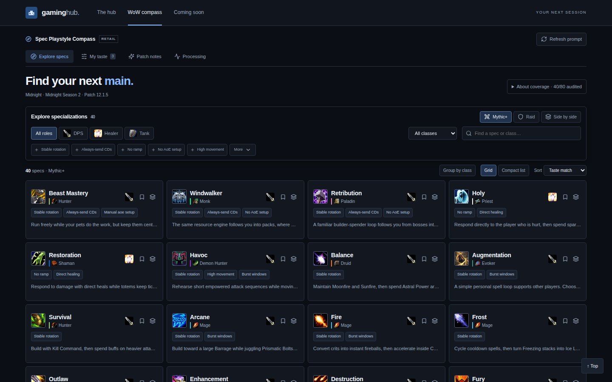
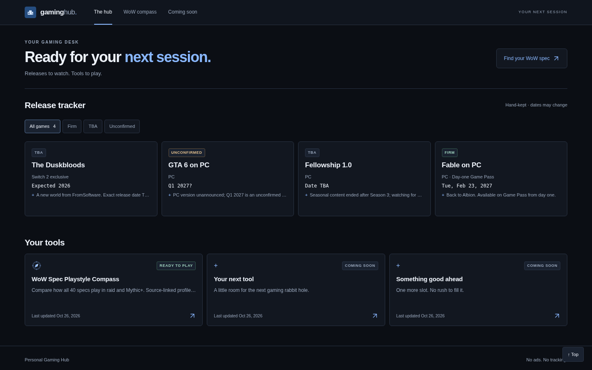
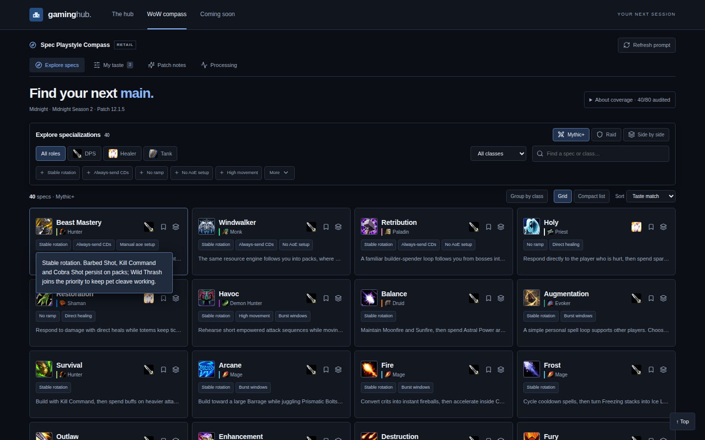
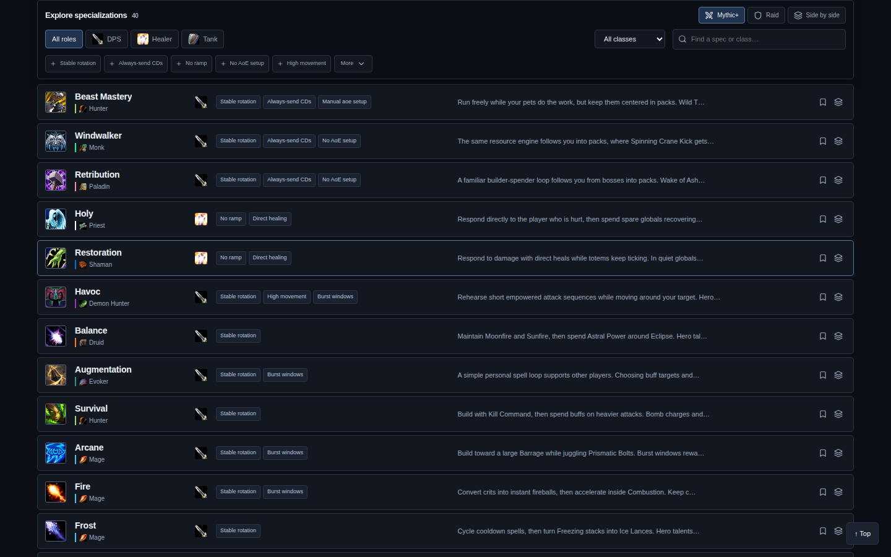
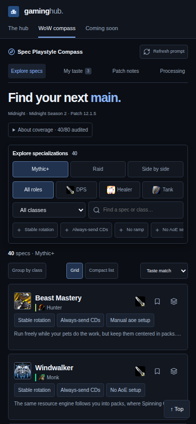
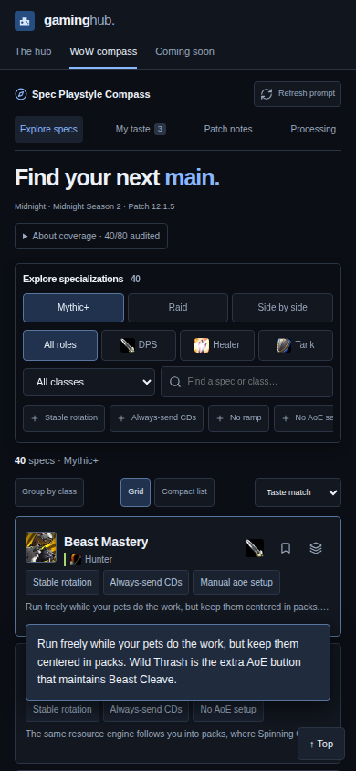
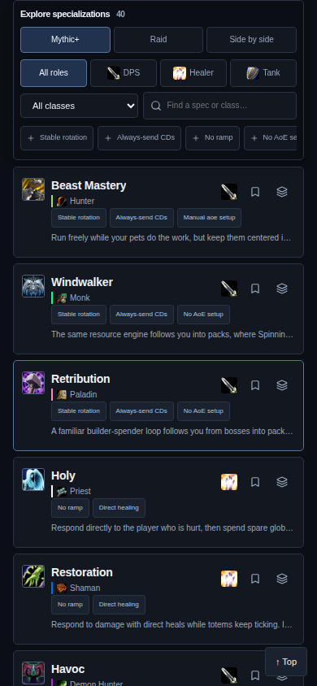
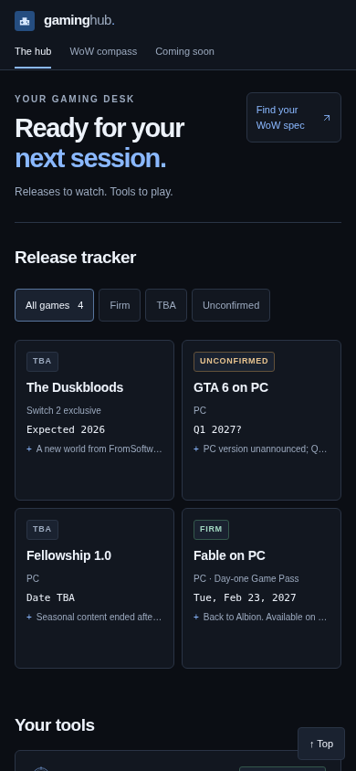

# Hub visual refresh · 2026-11-16

Baseline: `main` at `92e160a455d834ba0ea54b6753896c957a7a5ec2`. Branch: `codex/hub-design-refresh` → `main`. [PR #4](https://github.com/Ejgood21/gaming-hub/pull/4); do not merge.

The home page, release tracker, shared shell/navigation, placeholder page, and WoW tool now use one dark theme. Release and spec cards occupy aligned rows. A spec card contains its original spec/class/role art, up to three verified traits, and one feel line capped at 80 characters. Full profile text, dimensions, taste explanations, sources, and raid/Mythic+ comparisons remain in details. Badges and summaries expand on mouse hover, keyboard, or touch, without changing card height.

Search/class/role/feel filters remove nonmatching cards. The filter bar stays visible while scrolling. Grid and compact-list views, class grouping/collapse, jump navigation, and back-to-top reduce navigation cost. Taste matching, saved specs, comparisons, the exact per-patch prompt copy action, and all 80 profiles remain available.

| Measurement | Before | After |
| --- | ---: | ---: |
| Complete spec cards in initial 1440×900 viewport | 0 | 12 |
| Complete cards with the grid aligned below the toolbar, 1440×900 | 3 | 20 |
| Spec-card height, desktop | 543.2–585.5px | 138px grid / 58px list |
| Average displayed card words, closed disclosures | 103.4 | 17.1 |
| Feel summary, mean / maximum characters | 124.5 / 180 | 79.8 / 80 |
| Desktop grid height for 40 specs | 8057.9px | 1452px |
| Desktop full WoW page height | 9101px | 2000px |
| Desktop scrollable distance (page height − 900px) | 8201px | 1100px |
| Complete spec cards in initial 390×844 touch viewport | 0 | 2 |
| Mobile spec-card height | 620.9–704.4px | 132px grid / 112px list |
| Mobile full WoW page height | 27654px | 6244px |
| Mobile scrollable distance (page height − 844px) | 26810px | 5400px |
| Complete release cards in initial desktop viewport | 0 | 4 |
| Desktop release-card height | 335.5px | 182px |
| Mobile release-card height | 314–331px | 176px |
| Mobile home page height | 2366px | 1391px |

The desktop WoW page is 78.0% shorter; its grid is 82.0% shorter. Closed-card word count fell 83.5%. Counts include only fully visible cards; intersecting-card counts and exact geometry are in [measurements.json](measurements.json). “Grid aligned” is a separate measurement after scrolling to the list, with the visible toolbar excluded from usable space. Before and after use the same viewport and default taste/content settings. Character counts use the closed summary text; CSS may ellipsize it further to fit its one-line width.

Original icon artwork is served by [Wowhead's Blizzard icon CDN](https://wow.zamimg.com/images/wow/icons/large/). All 40 specialization textures were checked against their linked Wowhead Spec Basics guides; Devourer now uses `classicon_demonhunter_void` rather than the Demon Hunter class icon. The 13 class textures and 3 role symbols are distinct original Blizzard art. Role symbols use `inv_shield_06` (tank), `spell_holy_flashheal` (healer), and `inv_sword_04` (DPS). No Lucide glyph, emoji, or invented placeholder represents a class, spec, or role.

[icons.json](../../apps/wow/config/icons.json) records game IDs, guide/class references, CDN names, and SHA-256 checksums. All 56 JPEGs are committed under `apps/wow/assets/icons/`. Tests pin the independent game-ID/texture mapping, class and role mappings, 56 distinct filenames/byte hashes, JPEG validity, and checksums. Missing or corrupted cache files fail the build. Runtime load failure retries the same art on the CDN, then uses its readable identity text. The SSR-before-hydration failure case is handled. Both fallback paths were exercised in the successful [GitHub Chromium capture](https://github.com/Ejgood21/gaming-hub/actions/runs/43919766435). Artwork © Blizzard Entertainment; this is an unaffiliated fan tool.

Coverage remains one collapsed **About coverage** section. It distinguishes the existing **40/80 collected-source audit** (Mythic+ 40/40, raid 0/40) from the preserved published snapshot's **0/80 required-source target**. These were already different at the baseline. The candidate remains blocked; the refresh does not promote it or invent data. Published profiles, candidate archive, latest pointer, spec catalog, schema, patch prompt, and both coverage audits were verified byte-for-byte against `92e160a`. No data/schema/audit file changed.

Validation: all **69 tests passed**, and the **`/gaming-hub/` build passed** in GitHub Actions. [Final PR checks](https://github.com/Ejgood21/gaming-hub/pull/4/checks) repeat these on the final branch head. The full Chromium acceptance check also passed locally against the CI-built static exports with the final shared CSS/home template, at **1440×900** and **390×844 with touch**. It checks every card icon, fixed heights, the actual layout viewport and horizontal overflow, badge/summary hover/keyboard/tap behavior, class/role/search/feel filtering, group collapse and jumps, details, comparisons, taste persistence, prompt copying, and release filtering/disclosures. Screenshots below were reviewed. The temporary capture workflow and preview archive are removed from the final branch.

Before captures: [desktop WoW](desktop-before-wow.png), [desktop home](desktop-before-home.png), [mobile WoW](mobile-before-wow.png), [mobile home](mobile-before-home.png). The full-page captures show [all 40 desktop cards](desktop-all-specs.png) and [all 40 mobile cards](mobile-all-specs.png). Coverage captures: [desktop](desktop-coverage.png), [mobile](mobile-coverage.png).
